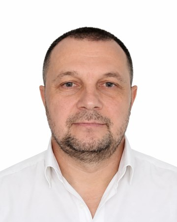

# Sergey Boyko

**Researcher in AI evaluation and verification · background in fraud and security investigations**
Almaty, Kazakhstan · Fellow, [Ronin Institute for Independent Scholarship 2.0](https://ronininstitute.org/scholars/) (independent affiliation)

**Quick links:** [LinkedIn](https://www.linkedin.com/in/sergey-boyko-researcher/) · [GitHub](https://github.com/sergeeey) · [ORCID](https://orcid.org/0009-0009-2178-5701)

For 20+ years I investigated fraud and prepared evidence for legal decisions: police investigator, then security and anti-fraud lead in finance and fintech (Director of Internal and Economic Security at a financial holding, seven legal entities, until September 2026). I now apply the same discipline to AI-generated results and scientific claims: test them against independent evidence, controls and counterexamples, and state where the result stops holding.

**Where to check this:** the Ronin Fellows page lists me; the ORCID record is linked above; commit history and decision files are in the repositories below. The AIAS+ acceptance notification and the correspondence about the startup selection can be shown on request.

## How I got here

I started in August 2023 as an ordinary AI user. A personal task needed a large archive of messages analysed; it did not fit into a model's context window, so I had to learn to build a vector database. That led me into programming, and then to the idea that the same tools could be used for science.

Three years later, self-taught, I am a Fellow of the Ronin Institute (since April 2026). A paper of mine is accepted as a poster at AIAS+ 2026. I was acknowledged for independent methodological review in a 2026 research manuscript. One of my projects reached the final three in a startup selection run in the quasi-government sector.

My long-term aim is a scientific discovery that helps people. Building research methods, and testing which of them actually produce new knowledge, is how I work towards it.

## Beyond research

The same tools are not only for science. The habit is the same on any task: state the claim, add a control, check the result. I use it on personal and family matters, on household decisions, and on automating routine workflows, from simple scripts to full processes. At work I used it to automate fraud-audit checks and to digitise a security database together with the workflows around it. The aim is that a person can do this for their own tasks, without a laboratory.

## Security background

- Set up and supervised the information-security direction in a quasi-government organisation, including a data-loss-prevention system, and sat on its information-security committee. Certificate in economic and information security.
- Built group-wide security procedures, staff vetting and investigation processes at a financial holding (seven legal entities).
- Went through many audits and inspections, and worked complex cases under pressure.
- My knowledge of information security is enough to build and run a programme and to work with specialists. I am a security manager, not a hands-on security engineer.

## Research

- **Acknowledgment in a physics preprint (August 2026):** Named by Thomas J. Buckholtz in the [acknowledgments of *Multi-Tier Newtonian Gravity: A Cosmic-Node-Based Alternative to LCDM for the Hubble Tension*](https://www.preprints.org/manuscript/202608.0943) for useful advice or perspective. This is an acknowledgment, not co-authorship or peer-reviewed publication.
- **AIAS+ 2026:** the paper *Kill Before You Commit: A Falsification-First Loop for AI-Assisted Scientific Discovery* is accepted for a poster presentation (5–7 November 2026). It remains under second-round review for the conference proceedings and is not yet accepted for publication.
- **Method:** falsification first. A separate AI agent tries to break an initial analysis; verified findings are kept apart from inferences and open claims.
- **Own result downgraded after self-audit.** [ARCHCODE](https://github.com/sergeeey/ARCHCODE) reported a pooled AUC of 0.977 on the HBB locus (1,103 ClinVar variants in its locus table: 353 pathogenic, 750 benign). The audit in its README shows that the figure follows variant-category composition: with a position-only control the AUC is 0.551, and the median within-category AUC across 25 category-locus combinations is 0.52, both close to chance. The caveat is at the top of that README, next to the number.

## Testing my own methods

I build research-process methods (a falsification ladder, estimand-first gates, an evidence ledger) and ask one question of each: does it produce knowledge that a plain baseline would not? I test that with pre-registered claims, blind graders and negative controls, and file the outcome, rejections included, in [Claude-cod-top-2026/experiments](https://github.com/sergeeey/Claude-cod-top-2026/tree/main/experiments).

- **Full falsification protocol vs standard analysis** (blind-graded pilot, n=2 cases). The pre-registered claim "the protocol wins by at least 3 points" was rejected: the standard analysis scored higher on both cases (by 4 and 2 points).
- **Explicit 8-class hypothesis taxonomy vs baseline** (n=1). Claim rejected: both versions produced the target hypothesis. The grader passed its own negative control.
- **Two configuration-effectiveness experiments** were blocked by an infrastructure limit (a subprocess cannot authenticate). They are archived with the blocker documented, not reported as results.

These are small pilots about process, not benchmarks. [Y-17](https://github.com/sergeeey/Y-17-100-gipotez) applies the same methods to a list of about 141 open problems.

## Projects

| Project | What it does | Status and limits |
|---|---|---|
| [Skeptic Engine](https://github.com/sergeeey/Skeptic-Engine-2026-) | Adversarial checks for scientific data integrity: statistical artifacts and structural inconsistencies in genomics, proteomics and biomedical data. 360 unit tests (they check code behaviour, not detection accuracy). | Research toolkit. Finds anomalies, not misconduct. Results on simulated fabrication and on real fraud labels are reported separately; some experiments have n=59–99 with wide confidence intervals. |
| [ScannerGap](https://github.com/sergeeey/scannergap) | Maps where static analysis stops seeing. Gold subset: 23 annotated real CVEs scored HIT / PARTIAL / MISS against Semgrep and Bandit. Exploratory run: 83 of 135 CVEs (61.5%) missed by both. | Research prototype. The 135-CVE set is author-selected and its manifest is not frozen; reproducibility is not complete. CodeQL is a separate exploratory subset. Not a benchmark result. |
| [mcp-bouncer](https://github.com/sergeeey/mcp-bouncer) | Prompt-injection pre-filter for MCP servers and AI agents that read external content. Python standard library only, eight attack classes, MIT. | Heuristic pre-filter, not an LLM guardrail; a determined attacker can bypass it. |
| [methodology-router](https://github.com/sergeeey/A---6-methodology-router) | Local CLI that freezes research claims, routes them to methods through explicit gates and keeps a hash-chained evidence ledger. No PASS without a run receipt. | MVP. |
| [Claude-cod-top-2026](https://github.com/sergeeey/Claude-cod-top-2026) | Methodology for Claude Code: evidence markers, audit gates, anti-hallucination rules, validation-theater checks. MIT. | Used in my own projects. |

## Earlier work

Computational genomics (ARCHCODE, chromatin loop extrusion for regulatory variant interpretation) and spectral toy-model research ([N-7-GeoSpectra-Lab](https://github.com/sergeeey/N-7-GeoSpectra-Lab), with explicit non-claims). Both publish controls and negative results next to the headline.

## Tools

Python 3.11+ · pytest · GitHub Actions · Semgrep rules · CVE analysis (NVD) · reproducible experiment design with controls · LLM and AI-agent workflows.

## How I work, and what I am looking for

I run many small experiments. Each one has a stated claim, a control and a recorded verdict, and many end in a rejection.

A working view of mine, not a result: a domain expert who uses AI professionally and a newcomer who uses AI from a blank page approach a field differently. The expert knows which routes are closed. The newcomer does not, and sometimes walks a route the field dropped for no current reason. Most such routes fail for good reasons, so I bring each one with its controls, and the expert's time goes to the verdict rather than to guessing. I think the pair works better than either alone.

I work without a lab. I am looking to join a research group working on problems that can benefit people, where my tools and unusual routes get checked by domain experts. My tools fit best around AI evaluation and verification, scientific data integrity and AI safety. Remote collaboration is fine.

Open to research collaboration and roles in AI evaluation, AI safety and fraud/abuse investigations.
